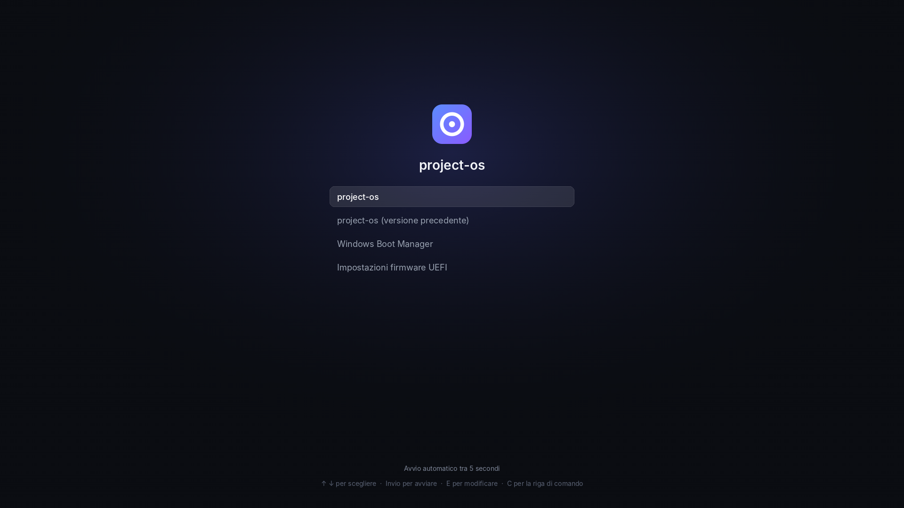

<p align="center">
  <picture>
    <source media="(prefers-color-scheme: dark)" srcset="branding/logo/project-os-logo-256.png">
    
  </picture>
</p>

<h1 align="center">project-os</h1>

<p align="center">
  Un sistema operativo costruito da zero sul kernel Linux, con un'interfaccia
  interamente web. Lo stesso sistema per PC e smartphone.
</p>

<p align="center">
  <strong>In sviluppo, non ancora utilizzabile.</strong> Oggi non c'è un'immagine da
  scaricare e installare: questa pagina descrive dove sta andando il progetto.
</p>

---

## Cos'è

project-os è un sistema operativo per **PC Intel e AMD** e per **smartphone e tablet**.
Tutto quello che vedi sullo schermo (pannelli, finestre, impostazioni, finestre di
dialogo, perfino l'installazione) è fatto con **HTML, CSS e JavaScript** e disegnato dal
motore web **WebKit**. Sotto c'è un sistema Linux essenziale, costruito pezzo per pezzo
dai sorgenti, senza partire da una distribuzione esistente.

## Cosa avrai

- **Un'interfaccia sola, ovunque.** Su PC e telefono giri lo stesso sistema e le stesse
  app; cambia solo il modo in cui si adattano allo schermo e al tocco. Lo stile grafico
  unisce elementi di Windows 11, macOS e MIUI.
- **I tuoi dispositivi che lavorano insieme.** PC e telefono con project-os si
  riconoscono e collaborano, come in un ecosistema:
  - file e link mandati da un dispositivo all'altro;
  - appunti condivisi;
  - notifiche, chiamate e SMS del telefono sul PC;
  - riprendere sul PC ciò che stavi facendo sul telefono, e viceversa.

  Tutto cifrato da un dispositivo all'altro, senza un cloud obbligatorio.
- **App che chiedono solo ciò che serve.** Ogni app dichiara in anticipo cosa vuole
  usare (file, fotocamera, rete…) e ottiene solo quello che approvi. Le app girano
  isolate l'una dall'altra; quando una chiede privilegi di amministratore, il sistema
  te lo chiede con una finestra chiara e se lo annota.
- **Un sistema che non si rompe.** Il sistema è in sola lettura e verificato a ogni
  avvio. Gli aggiornamenti sono firmati e si installano su una seconda copia: se
  qualcosa va storto, al riavvio torni da solo alla versione precedente. I tuoi dati
  stanno su una partizione cifrata.
- **Anche su PC non recenti.** L'obiettivo è funzionare su PC a 64 bit anche datati,
  con avvio UEFI o BIOS e cifratura che non richiede il chip TPM.
- **Accanto a Windows.** Il menu di avvio rileva Windows e gli altri sistemi già
  installati, per scegliere ogni volta quale avviare.

<p align="center">
  
  <br>
  <sub>Anteprima del menu di avvio, con il logo segnaposto.</sub>
</p>

## Su cosa girerà

| Dispositivo | Come si installa |
|---|---|
| PC desktop e portatili Intel/AMD a 64 bit | Da chiavetta USB, con una procedura guidata: lingua, tastiera, disco (anche accanto a Windows), cifratura, utente |
| Google Pixel (primo telefono supportato) | Dalla recovery del telefono; al primo avvio una procedura guidata chiede rete, utente e codice di sblocco |
| Vecchi modelli Oppo e Samsung | In seguito, modello per modello |

Sui telefoni serve un bootloader sbloccabile: dipende dal modello e, a volte,
dall'operatore.

## A che punto siamo

Lo sviluppo procede dal basso verso l'alto, una fase alla volta: prima il sistema di
base, poi la grafica, poi le app.

| Fase | | Stato |
|---|---|---|
| 0 | Fondamenta e decisioni | quasi completata |
| 1 | Sistema base: kernel, avvio, partizioni | in corso |
| 2 | Grafica: WebKit e compositore | da fare |
| 3 | Permessi e isolamento delle app | da fare |
| 4 | Runtime delle app | da fare |
| 5 | Interfaccia e stile grafico | da fare |
| 6 | App di sistema: impostazioni, file, terminale | da fare |
| 7 | Smartphone e tablet | da fare |
| 8 | Installazione e aggiornamenti | da fare |
| 9 | Ecosistema tra dispositivi | da fare |

Il dettaglio di ogni passo è in [`ROADMAP.md`](ROADMAP.md).

## Per chi vuole costruirlo

Oggi si può solo costruire da sorgenti il sistema di base, per sviluppo. Serve una
macchina Linux robusta (indicativamente 16 GB di RAM e 250 GB di disco); la prima build
richiede diverse ore.

```sh
git clone https://github.com/aptecstudio/project-os.git
cd project-os
kas build kas/desktop-amd64.yml:kas/dev.yml
```

La configurazione `kas/dev.yml` permette l'accesso root senza password: serve solo per
le prove. Una guida completa, con gli script per preparare la macchina e provare il
sistema nell'emulatore QEMU, arriva con la Fase 1.

## Come è fatto

| Componente | Scelta |
|---|---|
| Costruzione del sistema | Yocto Project 6.0 (LTS), con kas |
| Kernel | Linux 6.18 LTS; sui telefoni, kernel e driver del produttore |
| Avvio | GRUB, con menu a tema e dual boot |
| Aggiornamenti | Due copie del sistema (A/B), pacchetti firmati |
| Motore web | WebKitGTK, da un [fork mantenuto dal progetto](https://github.com/aptecstudio/WebKit) |
| Componenti nativi | Rust |
| Grafica e input | Wayland |

Le scelte e il loro perché sono in [`MEMORY.md`](MEMORY.md); le regole di lavoro per
chi contribuisce, persone o agenti AI, in [`AGENTS.md`](AGENTS.md).

## Licenza

Il codice di project-os è rilasciato con licenza [GNU GPL v3](LICENSE). Il fork di
WebKit mantiene le licenze originali di WebKit. Il font Inter, usato nel menu di avvio,
è distribuito con licenza SIL Open Font License 1.1.
